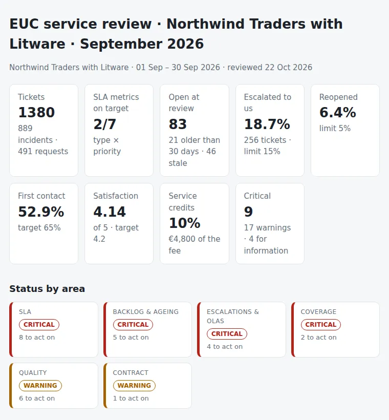

# EUC Provider Service Review

The monthly service review of an end-user computing service run by a provider, built from a ticket export: the SLA scorecard per priority with the breach list, the backlog and its ageing, what the provider escalated to the internal teams and whether those teams met their OLAs, how the service does out of hours, the quality signals that a compliance figure hides (reopens, first-contact resolution, satisfaction, tickets closed at the last minute or parked in pending), and the service credits the contract says are due. One CSV, one JSON with the targets, one Python command, and the agenda for the meeting: **what to raise with the provider, and what we owe them.**

Python 3.10+, standard library only. Runs with fictional demo data out of the box; a read-only PowerShell exporter for Jira Cloud is included, and ServiceNow list exports load as they are.



## Why

The provider's monthly pack says 96% and the users say the service is slow. Both are usually right:

- the **P2 resolution** figure excludes the tickets that spent a week in "waiting for customer";
- the **out-of-hours** P2s wait for the follow-the-sun hand-over, and the average hides them;
- a fifth of the compliant tickets were closed in the **last 10% of the window**, met on paper, slow in practice;
- the provider's **escalation rate** to the internal teams is 19%, and the network team is sitting on 12 tickets from July, so the breach is ours, not theirs;
- the contract has **service credits** nobody has ever claimed, because nobody computed them.

A service review needs one set of numbers both sides accept, computed from the raw tickets with the rules written down. This tool is that: the rules are in `settings.json` and in `eucreview/checks.py`, and the breach list has a `cause` column for the provider to fill in.

## What it checks

| Area | Checks |
|---|---|
| SLA | Response and resolution compliance per ticket type and priority against the contractual target %, with business-hours or 24x7 clocks, pending time subtracted, and open tickets past their target counted as breaches. P1/P2 incidents still open. |
| Backlog & ageing | Open tickets at the review date by team and age bucket; tickets older than the limit (critical from ten per team); stale tickets with no update for a week; unassigned tickets. An open escalated ticket is counted with the team that received it. |
| Escalations & OLAs | Share of the provider's tickets escalated to internal teams against the agreed maximum; tickets handed over after half the window was used; OLA compliance per receiving team, with the clock starting at the hand-over; teams with escalations and no OLA. |
| Coverage | Response compliance in business hours against out of hours; urgent incidents outside hours without a timely response; share of tickets handled by the offshore desk, the onsite provider teams and unmapped teams. |
| Quality | Reopen rate, first-contact resolution, satisfaction and detractors, tickets resolved in the last 10% of the window, tickets that spent most of their life with the clock stopped, incidents resolved within two minutes of creation, resolved tickets without a category. |
| Contract | Service credits per missed metric from the credit bands, capped per month; volume against the contracted baseline. |

Outputs:

- `report.html`: single file, light and dark mode: the headline numbers, status by area, what to raise first, the scorecard with target marks, the worst breaches, the backlog by team with age buckets, escalations and OLAs, coverage, quality, and the credits.
- `service-review.md`: the agenda. Scorecard; to raise with the provider; what we owe the provider (OLAs and internal queues); contract; for information.
- `actions.csv`: one row per action, worst first, with the owner (provider, internal team or service owner) and `due` / `done` columns.
- `scorecard.csv`: compliance per type and priority.
- `breaches.csv`: every breach with the actual and target times, and `cause` / `accepted_yes_no` columns for the provider.
- `ageing.csv`: the open tickets with age, bucket, idle days and a `decision` column for the ageing review.
- `escalations.csv`: every escalation with the hand-off delay and the OLA clock.
- `findings.csv`.

How to run the review, before, during and after the meeting: [docs/service-review-runbook.md](docs/service-review-runbook.md). Column aliases and settings: [docs/data-format.md](docs/data-format.md).

## Try it

```bash
git clone https://github.com/inigogonzalezgarcia/28-euc-provider-service-review.git
cd 28-euc-provider-service-review
python -m eucreview demo
```

Open `output/report.html` and `output/service-review.md`.

### The demo data

The demo is a made-up trading company, Northwind Traders, with offices in Madrid, Milan, Lisbon and Warsaw, whose end-user service is run by a fictional provider, Litware: an offshore service desk in Bengaluru and onsite teams in three offices, with four internal teams behind them. The review covers September 2026 and is held on 22 October: 1,454 tickets in the file, 1,380 created in the month (936 incidents and 518 requests in total), 83 still open. Names, targets, fees and events are invented.

The problems are placed on purpose:

- **SLA:** P2 incident resolution at 82% against 95%; one P1 on a Saturday night with a 3-hour response; P3 requests at 83%; two P2 incidents still open after three weeks.
- **Backlog:** 12 network tickets from July escalated by the desk and never closed; six hardware requests and three printer incidents older than 30 days with the onsite teams; 25 recent tickets with no update for a week; four unassigned.
- **Escalations:** 19% of the provider's tickets escalated to internal teams (limit 15%); 43 handed over after half the window; the network team's OLA at 74%; the business applications team receiving escalations with no OLA at all.
- **Coverage:** response within target 96% in business hours, 85% outside; five urgent incidents outside hours without a timely response; a "Facilities" queue not mapped to anyone.
- **Quality:** reopen rate 6.4% (limit 5%); first-contact resolution 53% (target 65%); satisfaction 4.14 with 11% detractors; 17% of compliant tickets resolved in the last 10% of the window; 33 tickets parked in pending; 17 printer incidents resolved one minute after creation; 28 without a category.
- **Contract:** credits of 13% uncapped, 10% after the cap (€4,800 of a €48,000 fee); volume 25% above the contracted baseline.

## Use it with your own tickets

1. Export the month's tickets plus everything still open to `data/tickets.csv`:
   ```powershell
   .\scripts\Export-JiraTickets.ps1 -Site https://contoso.atlassian.net -Jql 'project = SD AND (created >= -60d OR resolution = Unresolved)' -OutputPath .\data\tickets.csv
   ```
   - It is read-only; it asks for your Atlassian e-mail and an API token and stores nothing.
   - Custom field ids are at the top of the script: check them against your instance on the first run.
   - From ServiceNow, a list export of incidents and requested items with the usual columns loads without changes.
2. Write `data/settings.json` with the contract: team lists, business hours, SLA targets per priority, OLAs, limits, fee and credit bands ([docs/data-format.md](docs/data-format.md) has the full example).
3. Build the outputs:
   ```bash
   python -m eucreview review data/ --title "EUC service review · October" --period 2026-10
   ```
   Options:
   - `--period 2026-10` or `--period 2026-10-01:2026-10-31` sets the month; `--as-of 2026-11-05` the review date;
   - `--late-window-share 15`, `--pending-share 50` and `--instant-close-min 2` change the quality thresholds.

The export says who waited how long for what. Keep it inside your organisation:

- real files at the top level (`tickets*.csv`, `settings.json`, `data/`) and the `output/` folder are excluded from Git by `.gitignore`;
- only the fictional files in `sample_data/` are committed;
- the exporter reads ticket fields; it never reads comments, attachments or user directories.

## Tests

```bash
python -m unittest discover tests      # or: pip install -r requirements-dev.txt && python -m pytest
```

There are 16 tests:

- **Parsing:** dates in ISO, European and offset formats; priority and type aliases from Jira and ServiceNow; a semicolon file with a BOM; the last full month chosen when no period is given.
- **Clocks:** business minutes across nights, weekends and holidays, and the generator's clock agreeing with the checker's.
- **SLA:** pending time subtracted on a 24x7 clock; open tickets past target counted as breaches; the scorecard and the breach list; last-minute resolutions.
- **Backlog:** age buckets, stale tickets, and an open escalated ticket owned by the team that received it.
- **Escalations:** OLA met and missed, hand-off share, teams without an OLA, the escalation rate finding.
- **Coverage:** the in-hours against out-of-hours gap and urgent incidents on a weekend.
- **Quality:** reopen, first-contact resolution, satisfaction, instant closes, pending-heavy tickets and missing categories.
- **Contract:** credit bands and the monthly cap; a clean service with no findings.
- **Demo end to end:** every check fires, all eight outputs are written, the agenda has both sides' sections, and the data is deterministic.

**Next steps for your service:**

- run it on last month's export next to the provider's own pack and reconcile the two before the meeting; the difference is the exclusions, and that is the first thing to agree;
- put the OLAs in `settings.json` only after the internal team leads have agreed them, or the report will say they failed something they never signed up for;
- keep each month's `output/` folder so the third review can show the trend.

## Background

Built from my work managing end-user services with providers, including:

- service management with SLAs and OLAs defined and followed, and provider and contract negotiation;
- backlog, ticket quality and ageing follow-up, and support escalations with offshore teams;
- process ownership for incidents, requests, changes (CAB) and problems, with process dashboards;
- Jira Service Management and Confluence administration, and the Atlassian relationship;
- leading the technical response to major incidents and the post-mortems that follow.

Written from scratch with fictional data; no employer data, contracts or tickets are used.

## Customisation and contact

Want this adapted to your service? For example:

- reading the tickets straight from Jira, ServiceNow or HaloITSM instead of a CSV;
- the pending rules of your contract (which statuses stop the clock, and for how long);
- a trend view across months, or one scorecard per site;
- the provider's pack and yours reconciled automatically.

Get in touch:

- Website (contact form): [inigogonzalezgarcia.github.io](https://inigogonzalezgarcia.github.io/about.html#contacto)
- LinkedIn: [linkedin.com/in/igonzalez93](https://www.linkedin.com/in/igonzalez93)

## License

MIT
